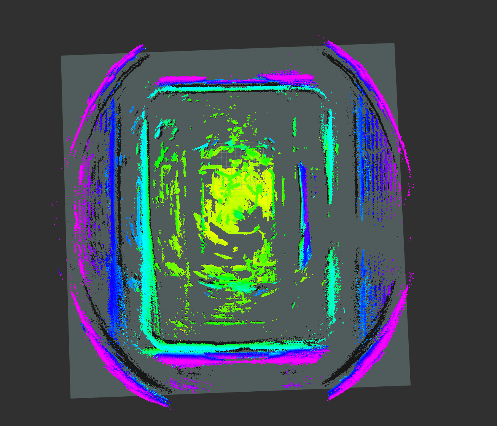
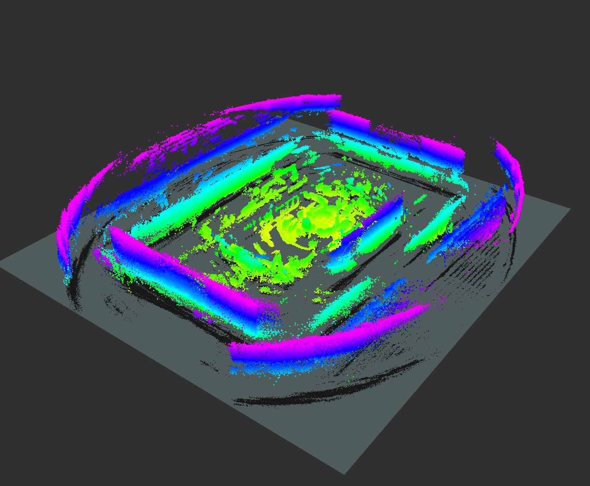
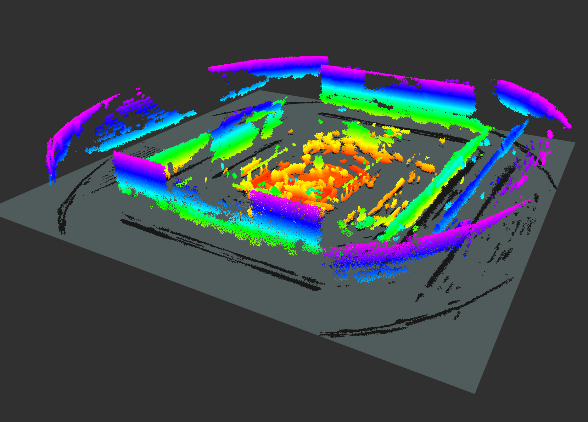

# RoboMaster Assignment5：MID360 离线建图与地图处理

本项目使用 Livox MID360 雷达及 IMU 的 rosbag，通过独立的 Point-LIO ROS 2 工作空间生成三维地图，再由 `mid360_mapping/map_processor_node` 处理完整地图并发布二维 `OccupancyGrid`。

实际环境：Ubuntu 24.04 LTS、ROS 2 Jazzy、C++17、PCL。Point-LIO 与 Livox 驱动分别在独立工作空间编译。

## 当前结果与验证边界

- 已在本机运行 Point-LIO，观察过配准点云与连续轨迹，并保存完整 PCD。
- 已从完整 PCD 完成体素降采样、高度筛选、二维投影、PCD/PGM/YAML 保存，以及 Nav2 加载历史二维地图。
- 本次展示的原始 PCD 发布日志为 **2,071,950 点**。点数随文件版本变化，以当前文件为准。
- 已在 RViz 的 `camera_init` 下同时显示完整三维点云与二维地图，两项均为 `Status: Ok`。
- 本次代码补充了显式有限值清理、可选统计离群点过滤、输入坐标系检查、保存错误检查及默认防覆盖保护。当前版本已在 Ubuntu/Jazzy 本机完成编译与 A/B 两组运行；保存文件通过结构验证。下方为当前代码运行后的 A 组截图。





截图中全局 `No tf data` 提示仍存在；两个数据源与 Fixed Frame 相同，两项显示均正常。没有为消除提示添加未经验证的静态 TF。截图支持检查显示链路和主要轮廓对应关系，不证明里程计精度。

## 依赖与编译

现有工作空间：

| 路径 | 用途 |
|---|---|
| `~/assignment5` | 地图处理、显示配置和文档 |
| `~/ws_livox` | Livox ROS Driver2 与 CustomMsg |
| `~/ws_point_lio` | 实际 Point-LIO 源码与 `PCD/scans.pcd` |
| `~/ws_point_lio_ws` | Point-LIO colcon 工作空间 |

需要 ROS 2 Jazzy、`rclcpp`、`nav_msgs`、`sensor_msgs`、`std_srvs`、PCL、`pcl_conversions`、`pcl_ros`、RViz2、`python3-yaml` 和已编译的 `livox_ros_driver2`。Nav2 Map Server 仅用于可选的磁盘地图加载。

已有环境无需重新安装。若移到新电脑，可先安装功能包依赖：

```bash
source /opt/ros/jazzy/setup.bash
source ~/ws_livox/install/setup.bash
cd ~/assignment5
rosdep install --from-paths src --ignore-src -r -y --rosdistro jazzy
colcon build --symlink-install --packages-select mid360_mapping
source install/setup.bash
```

Livox 驱动及 Point-LIO 算法源码不包含在本仓库中。实际 Point-LIO 来源为 `Thetrafficlights/Point-LIO-ros2`，提交 `155f46da0b1eb3fc7c7facf43b00cb124631c807`，本机将构建选项统一为 C++17 并修改 MID360 配置。实际配置、启动文件快照、构建补丁及新目录还原方法见 [Point-LIO 复现说明](docs/point_lio/README.md)。仓库旧模板使用 Humble，本项目实际运行环境为 Jazzy；跨电脑完整重建尚未实测。

## 最短复现：从已有 PCD 显示地图

此流程不需要 rosbag、Point-LIO 在线运行或 Map Server。先停止旧的 PCD 发布、地图处理和 RViz 进程，避免同名节点与重复发布。

```bash
source /opt/ros/jazzy/setup.bash
source ~/ws_livox/install/setup.bash
source ~/assignment5/install/setup.bash
cd ~/assignment5

ros2 launch mid360_mapping pcd_preview.launch.py \
  pcd_path:=$HOME/ws_point_lio/PCD/scans.pcd \
  publishing_period_ms:=1000
```

新增入口同时启动 PCD 发布、地图处理和 RViz；使用实际时间，无需 `/clock`。默认创建带时间戳的 `maps_preview_日期_时间` 输出目录；**启动不会保存地图，已有地图默认不允许覆盖**。当前入口代码默认发布周期为 10 秒；以上命令显式使用本机已成功展示的 1 秒。大点云仍可能出现接收间隔，不能仅按计时认定处理完成。

PCD 发布参数是已在本机确认的 `tf_frame`，不是 `frame_id`。本入口将它设为 `camera_init`。PCD 本身不携带 ROS TF；设置此标签的前提是文件坐标确实为 Point-LIO 的全局坐标，不能用修改标签代替几何变换。

话题：

| 话题 | 类型 | 坐标系/内容 |
|---|---|---|
| `/pcd_full_map` | `sensor_msgs/msg/PointCloud2` | `camera_init`，完整原始地图 |
| `/mapping/map_filtered` | `sensor_msgs/msg/PointCloud2` | `camera_init`，处理后障碍物点云 |
| `/mapping/map_2d` | `nav_msgs/msg/OccupancyGrid` | `camera_init`，二维障碍物投影 |

RViz 配置为 `src/mid360_mapping/rviz/pcd_alignment.rviz`。Fixed Frame 为 `camera_init`，Map Alpha 为 0.5。改变视角可检查俯视轮廓和立体结构；高度截断后的二维范围不必覆盖所有原始三维点。


没有原始 scans.pcd 时，可以展示仓库内已提交的障碍物 PCD（不是重新执行原始点云实验）：

```bash
ros2 launch mid360_mapping pcd_preview.launch.py \
  pcd_path:=$HOME/assignment5/maps/map.pcd publishing_period_ms:=1000
```

上述流程会再次处理已筛选的点云，不能将其点数作为原始 PCD 的 A/B 结果。当前本机为处理后点云增加了 Reliable + Transient Local 发布，并匹配 RViz 接收设置，保留最近一张快照；这属于显示传输配置变化，不改变过滤参数。A/B 均应使用相同版本。按 Z 高度着色时，两组需固定相同色标范围；截图作为辅助，定量结论来自点数和文件统计。

## 处理流程与参数

```text
Point-LIO 完整 scans.pcd
→ pcl_ros 发布 /pcd_full_map
→ 检查输入坐标系
→ 去掉 XYZ 中含 NaN/Inf 的点
→ VoxelGrid 体素降采样
→ 可选 StatisticalOutlierRemoval
→ 按 z 高度筛选
→ 发布障碍物点云 + 投影为 OccupancyGrid
→ 手动触发保存服务
```

每次收到完整地图都独立处理，不把完整快照重复累加到旧地图。非有限 intensity 重置为 0；不参与几何清理判断。

| 节点参数 | 默认值 | 含义 |
|---|---|---|
| `input_topic` | `/pcd_full_map` | 完整点云输入 |
| `map_frame` | `camera_init` | 期望输入及输出坐标系；不一致时拒绝处理 |
| `output_directory` | `./maps` | 节点直接运行时的保存目录；新 launch 使用带时间戳目录 |
| `voxel_size` | `0.10` | 体素边长，米 |
| `grid_resolution` | `0.10` | 每个二维格子的边长，米 |
| `obstacle_height_min/max` | `0.15 / 1.50` | 节点直接运行默认高度，米 |
| `remove_outliers` | `false` | 是否启用统计离群点过滤 |
| `outlier_mean_k` | `20` | 邻域点数量 |
| `outlier_stddev` | `1.0` | 距离标准差倍数 |
| `overwrite_existing` | `false` | 保存时是否允许覆盖同名成果 |

**新展示 launch 的 `height_min/max` 默认是 `-10 / 10`**，用于复现已经成功的诊断展示，不代表导航障碍高度。它们对应节点的 `obstacle_height_min/max`。高度应相对于重力对齐后的地图理解，不能未经测量就声称是距地面高度。

栅格宽高为 `floor(跨度/分辨率)+1`，避免最外侧点落到边界外；原点为筛选后点云最小 x、y，方向为单位四元数。栅格总数上限为 2500 万，以避免异常范围造成过大分配。

占据格为 `100`，没有可靠观测的格子为 `-1`。目前没有射线清除，不主动生成空闲格 `0`。PGM 对应：障碍 `0`（黑）、未知 `205`（灰）、空闲 `254`（白）。PGM 保存时反转行顺序，使图片坐标与 OccupancyGrid 坐标对应。

### 参数对比（2026-10-28，本机实测）

两组输入均为 `~/ws_point_lio/PCD/scans.pcd`，日志原始点数均为 2,071,950。固定体素 0.10 米、栅格 0.10 米、高度区间 [-10, 10] 米及 camera_init 坐标系，只改变统计离群点过滤开关。该高度区间用于本次诊断展示，未被证明是合适的导航障碍物区间。

| 项目 | A：离群过滤关闭 | B：离群过滤开启 |
|---|---:|---:|
| 原始点数 | 2,071,950 | 2,071,950 |
| 有效点数 | 2,071,950 | 2,071,950 |
| 体素后点数 | 1,042,586 | 1,042,586 |
| 离群过滤后点数 | 未启用，保留 1,042,586 | 941,119 |
| 高度过滤后点数 | 319,779 | 293,332 |
| 二维宽 × 高 | 719 × 729 | 679 × 718 |
| 占据格数 | 72,806 | 57,807 |
| 未知格数 | 451,345 | 429,715 |
| 空闲格数 | 0 | 0 |
| 二维原点 x / y（米） | -37.78382873535156 / -47.69228744506836 | -34.26485824584961 / -47.196632385253906 |

A 点数来自当前运行日志，A 地图统计来自此前已保存、已验证并提交的相同配置基线；B 的 remove_outliers 参数读取为 True，保存服务返回 success=True，文件结构验证通过。B 的 SOR 参数沿用代码默认 mean_k=20、stddev=1.0。原始 PCD 未在实验开始前记录内容散列，实验以相同路径、点数和参数为依据；未进行重复试验与真实场景精度评估。

复现命令（新开终端先加载上述 ROS 环境，顺序运行，停止 A 后再启动 B；已有输出目录不要覆盖）：

```bash
# A
ros2 launch mid360_mapping pcd_preview.launch.py \
  pcd_path:=$HOME/ws_point_lio/PCD/scans.pcd \
  publishing_period_ms:=1000 \
  voxel_size:=0.10 grid_resolution:=0.10 \
  height_min:=-10.0 height_max:=10.0 remove_outliers:=false \
  output_directory:=$HOME/assignment5/maps_preview_A_current

# B
ros2 launch mid360_mapping pcd_preview.launch.py \
  pcd_path:=$HOME/ws_point_lio/PCD/scans.pcd \
  publishing_period_ms:=1000 \
  voxel_size:=0.10 grid_resolution:=0.10 \
  height_min:=-10.0 height_max:=10.0 remove_outliers:=true \
  output_directory:=$HOME/assignment5/maps_preview_B_current
```

等待当前组出现非零高度过滤点数后，在另一终端手动调用保存服务；验证脚本的路径改为该组目录。不得把上一组保留的画面或缓存误当成新结果。



**观察与结论：**

- SOR 在体素后去掉 101,467 点，占体素后点数的 **9.73%**。其中被去掉的点并不都位于后续高度区间内。
- 高度过滤后的最终点云由 319,779 降到 293,332，减少 26,447 点，即 **8.27%**。
- 占据格由 72,806 降到 57,807，减少 14,999 格，即 **20.60%**。说明过滤开关不仅改变点数，也改变了二维障碍物覆盖。
- 二维范围由 71.9 × 72.9 米变为 67.9 × 71.8 米。原点同时改变，这是按过滤后点云边界生成栅格的结果，不能误认为两组坐标系不同，也不能直接按图像像素下标做差；几何对比须按 YAML 原点和分辨率配准到同一世界坐标。
- 截图仍可见主体结构，但两组所提交裁剪图的视角、颜色范围没有独立验证完全一致，不据此做严格视觉优劣排序。删除更多点不等于地图更准确，也无法确认边界点全是噪声。
- 当前 `maps/` 保留已验证的 A 组基线，不用 B 组覆盖已有成果。B 组作为滤波敏感性实验：展示统计离群过滤能减少点云和占据格，同时存在误删稀疏有效结构的可能。后续应结合真实场景及局部结构检查选择强度。

这次实验完成了“比较不同参数效果”的一次单变量对比；没有测量计算时间、定位误差或导航成功率。实测汇总见 [CSV](docs/experiments/ab_results.csv)。

## 保存与地图文件验证

等待日志出现高度筛选后的非零点数和 RViz 二维地图后，在另一终端加载 ROS 环境，再手动调用：

```bash
source /opt/ros/jazzy/setup.bash
ros2 service call /mapping/save_artifacts std_srvs/srv/Trigger '{}'
```

保存目录以启动参数与服务响应为准，生成 `map.pcd`、`map.pgm`、`map.yaml`。其中 PCD 是**高度筛选后的障碍点云**，不是原始完整 Point-LIO 地图。完整地图保留在 `~/ws_point_lio/PCD/scans.pcd`。

保存服务会拒绝空缓存及已有同名文件，并检查 PCD 返回值和 PGM/YAML 文件流错误。三个文件依次写入，尚未实现三文件事务；若中途写失败，保留现场，使用新的空目录重试，不把残留文件视为成功成果。

```bash
# 将下面路径替换为实际输出目录
python3 ~/assignment5/scripts/validate_maps.py ~/assignment5/maps_preview_A
```

脚本检查 PCD 字段/点数和普通 binary 数据长度、PGM 宽高与像素长度、YAML 图像引用/分辨率/原点/阈值，并报告像素统计。它不检查几何精度；ASCII/compressed PCD 仅检查头部，不完整解码。已提交 A 基线地图在本机和审查环境均通过结构检查；按节点生成参数 0.10 米重投影 A 的 PCD，与 PGM 的不同格数为 0。B 组文件在本机通过结构验证，尚未上传供独立重投影检查。

最终选定并验证地图后，放入仓库根目录的 `maps/`：

```text
maps/
├── map.pcd
├── map.pgm
└── map.yaml
```

可以用安全复制脚本整理选定结果，先校验源文件，再复制；目标已有地图时会拒绝覆盖：

```bash
python3 ~/assignment5/scripts/finalize_maps.py \
  ~/assignment5/maps_preview_A ~/assignment5/maps
```

修改后的 `.gitignore` 明确保留以上三个最终文件，排除历史地图目录、rosbag 和编译产物。

可选：Nav2 Map Server 加载 YAML 后通常发布 `/map`，其 frame 可与原处理节点不同。最终截图优先直接订阅 `/mapping/map_2d`，无需为展示额外制造 TF。

## 需要重新建图时：Point-LIO 与 rosbag

已有 PCD 的展示不运行这一节。确需重新建图时，先备份原始 PCD，避免 Point-LIO 的保存机制覆盖原成果。

终端 1，沿用本机已成功使用的入口：

```bash
source /opt/ros/jazzy/setup.bash
source ~/ws_livox/install/setup.bash
source ~/ws_point_lio_ws/install/setup.bash
ros2 launch point_lio point_lio.launch.py \
  point_lio_cfg_dir:=$HOME/assignment5/docs/point_lio/config/mid360.yaml \
  rviz:=False
```

终端 2：

```bash
source /opt/ros/jazzy/setup.bash
source ~/ws_livox/install/setup.bash
ros2 bag play ~/bags/rosbag2_2026_05_28-17_11_13 \
  --clock --rate 0.5 --start-paused \
  --topics /livox/lidar_192_168_1_140 /livox/imu_192_168_1_140
```

已核对随仓库保存的实际 MID360 配置，其雷达/IMU 话题与上述 rosbag 一致，IMU、轨迹、配准点云及 PCD 保存开关均开启。`use_imu_as_input: false` 是算法模式选择，不等于关闭 IMU。节点就绪后按空格开始播放；使用模拟时间的节点须先配置并核对 `use_sim_time`。

指定版本在正常退出处理循环后，将非空累计点云写到编译时源码目录下的 `PCD/scans.pcd`；原配置 `pcd_save.interval: -1` 表示不按固定帧数分段写入。运行前须备份同名原图，停止后检查文件时间、PCD 头部与日志。外参、IMU 单位和饱和值保留既有参数，本次未重新标定或证明建图精度。详见 [配置和构建记录](docs/point_lio/README.md)。

历史运行输出包括 `/cloud_registered`、`/path` 和 `/Laser_map`。`/path` 在重启后不会从 PCD 自动恢复。Point-LIO 的完整地图保存成功后再进入 PCD 处理流程，不能将未经确认的 `/Laser_map` 小快照当成完整地图。

`mapping_node.cpp` 是保留的模板输入节点：只转发当前帧并统计 IMU，未实现 LIO、配准或轨迹；它不能替代 Point-LIO，原有 `mapping.launch.py` / `replay.launch.py` 也不自动集成外部 Point-LIO。因此本项目的真实建图与地图处理采用两个独立步骤。该模板节点没有地图积累时，保存服务明确返回失败。

## 限制

rosbag 实际场景未知，不能仅凭环形外观判定地图好坏。当前未做真实场景精度评估、闭环验证、基于射线的空闲空间推断或自主导航测试；本输出是点云投影障碍物栅格图。高度范围和离群过滤强度需要结合真实数据选择。


